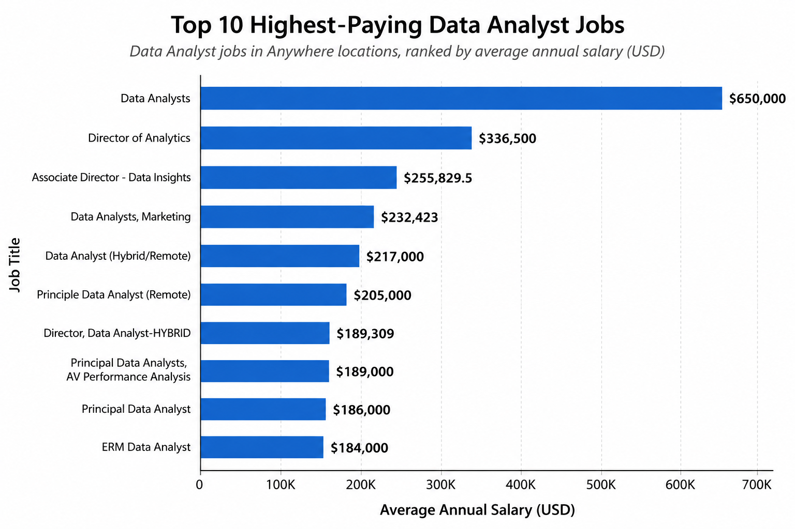
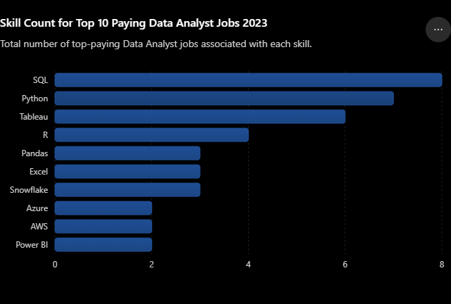

# Introduction
📊 Data Job Market in 2023! Focusing on 👩‍💻 Data Analyst roles, exploring 💰 top-paying jobs, in-demand skills, and high demand meets high salary in data analytics.

SQL Queries: [Project_sql folder](/Project_sql/)

# Background
We want to pin-point the optimal position and type of roles for data analyst that are top paid and in-demand jobs/

Data Hails from my [SQL Course] (https://lukebarousse.com/sql). Detail insights on job titles, salaries, locations, essential skills.

### Questions to obtain analysis of the optimal job/roles for data analyst:

1. What are top-paying data analysts job?
2. What skills are required for these top-paying jobs?
3. What skills are most in demand for data analysts?
4. Which skills are associated with higher salaries?
5. What are the most optimal skills to learn?

# Tools I used
- **SQL** (Query)
- **PostgreSQL** (Database management system)
- **VS Code** (Database management and executing SQL queries)
- **Gitt & Github**

# The Analysis
Each query for this project aimed at investigating specific aspects of data analyst job market.

### 1. Top Paying Data Analysts Jobs.
Identify highest-paying roles. I filtered **data analyst position by average yearly salary and location**, focusing on **remote jobs.** 


*Bar graph visualizing the salary for the top 10 salaries for data analysis; CHATGPT generated from my SQL results.*

- Highlights high paying opportunities in the field.
The breakdown of the top data analyst jobs in 2023:

- **Wide Salary Range:** Top 10 paying data analyst roles splan from $184,000 to $650,000, indicating significant salary potential in the field.
- **Diverse Employers:** Companies like SmartAsset, Metam and AT&T are among who offers high salaries, showing interest across different industries.
- **Job Title Variety:** High diversity in job titles (Data Analyst Director of Analytics), varied roles and specializations within data analytics.

```sql
SELECT
    job_id,
    job_title,
    job_location,
    job_schedule_type,
    salary_year_avg,
    job_posted_date,
    name AS company_name

FROM   
    job_postings_fact

LEFT JOIN company_dim ON job_postings_fact.company_id = company_dim.company_id

WHERE
    job_title_short = 'Data Analyst' AND
    job_location = 'Anywhere' AND
    salary_year_avg IS NOT NULL

ORDER BY 
    salary_year_avg DESC

LIMIT 10;
```


### 2. Skills for Top Paying Jobs
To see what skills in demand for top paying jobs, I joined job postings with skills data, providing insights what employers value for high compensation roles 



*The count of skills for the top 10 paying jobs for data analysts; ChatGPT generated this graph from my SQL results*

- SQL is leading with a bold count of 8.
- Python follows closely with a bold count of 7.
- Tableau is also highly sought after, with a bold count of 6. 
- Other skills like R, Snowflake, Pandas, and Excel show varying degrees of demand.

```sql
with top_paying_jobs AS (
    SELECT
        job_id,
        job_title,
        salary_year_avg,
        name AS company_name

    FROM   
        job_postings_fact

    LEFT JOIN company_dim ON job_postings_fact.company_id = company_dim.company_id

    WHERE
        job_title_short = 'Data Analyst' AND
        job_location = 'Anywhere' AND
        salary_year_avg IS NOT NULL

    ORDER BY 
        salary_year_avg DESC

    LIMIT 10
)

SELECT
    top_paying_jobs.*,
    skills
FROM top_paying_jobs
INNER JOIN skills_job_dim ON top_paying_jobs.job_id = skills_job_dim.job_id
INNER JOIN skills_dim ON skills_job_dim.skill_id = skills_dim.skill_id
ORDER BY
    salary_year_avg DESC
```

### 3. In-Demand Skills for Data Analysts

| Rank | Skill    | Demand Count |
| ---: | -------- | -----------: |
|    1 | SQL      |    **7,291** |
|    2 | Excel    |    **4,611** |
|    3 | Python   |    **4,330** |
|    4 | Tableau  |    **3,745** |
|    5 | Power BI |    **2,609** |

*Table of the demand for the top 5 skills in data analyst job postings*

- **SQL and Excel remain fundamental**, emphasizing the need for strong foundational skills in data processing and spreadsheet manipulation.

- **Programming and Visualization Tools** like Python, Tableau, and Power BI are essential, pointing towards the increasing importance of technical skills in data storytelling and decision support.

```sql
SELECT 
    skills,
    COUNT (skills_job_dim.job_id) AS demand_count
FROM job_postings_fact
INNER JOIN skills_job_dim ON job_postings_fact.job_id = skills_job_dim.job_id
INNER JOIN skills_dim ON skills_job_dim.skill_id = skills_dim.skill_id
WHERE 
    job_title_short = 'Data Analyst' AND
    job_work_from_home = True
GROUP BY
    skills
ORDER BY
    demand_count DESC
LIMIT 5;
```
### 4. Skills Based on Salary
 Average salaries with different skills revealed which skills are the highest paying.

| Rank | Skill         | Average Salary |
| ---: | ------------- | -------------: |
|    1 | PySpark       |   **$208,172** |
|    2 | Bitbucket     |   **$189,155** |
|    3 | Watson        |   **$160,515** |
|    4 | Couchbase     |   **$160,515** |
|    5 | DataRobot     |   **$155,486** |
|    6 | GitLab        |   **$154,500** |
|    7 | Swift         |   **$153,750** |
|    8 | Jupyter       |   **$152,777** |
|    9 | Pandas        |   **$151,821** |
|   10 | Elasticsearch |   **$145,000** |

*Table of the average salary for the top 10 paying skills for data analysts*

- **High Demand for Big Data & ML Skills:** Top salaries are commanded by analysts skilled in big data technologies (PySpark, Couchbase), machine learning tools (DataRobot, Jupyter), and Python libraries (Pandas, NumPy), reflecting the industry's high valuation of data processing and predictive modeling capabilities.
- **Software Development & Deployment Proficiency:** Knowledge in development and deployment tools (GitLab, Kubernetes, Airflow) indicates a lucrative crossover between data analysis and engineering, with a premium on skills that facilitate automation and efficient data pipeline management.
- **Cloud Computing Expertise:** Familiarity with cloud and data engineering tools (Elasticsearch, Databricks, GCP) highlighting growing importance of cloud-based analytics environments, suggesting that cloud proficiency significantly boosts earning potential in data analytics.

```sql
SELECT 
    skills,
    ROUND (AVG (salary_year_avg), 0) as avg_salary
FROM job_postings_fact
INNER JOIN skills_job_dim ON job_postings_fact.job_id = skills_job_dim.job_id
INNER JOIN skills_dim ON skills_job_dim.skill_id = skills_dim.skill_id
WHERE 
    job_title_short = 'Data Analyst' AND
    salary_year_avg is NOT NULL AND
    job_work_from_home = True
GROUP BY
    skills
ORDER BY
    avg_salary DESC
LIMIT 25;
```


### 5.Best/Optimal Skills To Learn

Combining analysis from demand and salary data, this query aimed to pinpoint skills that are both in high demand and have high salaries, providing a strategic focus for skill development.

| Skill ID | Skill      | Demand Count | Average Salary |
| -------: | ---------- | -----------: | -------------: |
|        8 | Go         |           27 |   **$115,320** |
|      234 | Confluence |           11 |   **$114,210** |
|       97 | Hadoop     |           22 |   **$113,193** |
|       80 | Snowflake  |           37 |   **$112,948** |
|       74 | Azure      |           34 |   **$111,225** |
|       77 | BigQuery   |           13 |   **$109,654** |
|       76 | AWS        |           32 |   **$108,317** |
|        4 | Java       |           17 |   **$106,906** |
|      194 | SSIS       |           12 |   **$106,683** |
|      233 | Jira       |           20 |   **$104,918** |
|       79 | Oracle     |           37 |   **$104,534** |
|      185 | Looker     |           49 |   **$103,795** |
|        2 | NoSQL      |           13 |   **$101,414** |
|        1 | Python     |          236 |   **$101,397** |
|        5 | R          |          148 |   **$100,499** |
|       78 | Redshift   |           16 |    **$99,936** |
|      187 | Qlik       |           13 |    **$99,631** |
|      182 | Tableau    |          230 |    **$99,288** |
|      197 | SSRS       |           14 |    **$99,171** |
|       92 | Spark      |           13 |    **$99,077** |
|       13 | C++        |           11 |    **$98,958** |
|      186 | SAS        |           63 |    **$98,902** |
|        7 | SAS        |           63 |    **$98,902** |
|       61 | SQL Server |           35 |    **$97,786** |
|        9 | JavaScript |           20 |    **$97,587** |

*Table of the most optimal skills for data analyst sorted by salary*

Conclusion of the most optimal skills for Data Analysts as of 2023:

- **High-Demand Programming Languages:** Python and R stand out for their high demand, with demand counts of 236 and 148 respectively. Despite their high demand, their average salaries are around $101,397 for Python and $100,499 for R. Proficiency in these languages is highly valued but also widely available.

- **Cloud Tools and Technologies:** Skills in specialized technologies such as Snowflake, Azure, AWS, and BigQuery show significant demand with relatively high average salaries, showing the growing importance of cloud platforms and big data technologies in data analysis.

- **Business Intelligence and Visualization Tools:** Tableau and Looker, with demand counts of 230 and 49 respectively, and average salaries around $99,288 and $103,795, highlight the critical role of data visualization and business intelligence in deriving actionable insights from data.

- **Database Technologies:** The demand for skills in traditional and NoSQL databases (Oracle, SQL Server, NoSQL) with average salaries ranging from $97,786 to $104,534, reflects the enduring need for data storage, retrieval, and management expertise.

```sql
SELECT 
    skills_dim.skill_id,
    skills_dim.skills,
    COUNT (skills_job_dim.job_id) AS demand_count,
    ROUND (AVG(job_postings_fact.salary_year_avg),0) AS avg_salary
FROM
    job_postings_fact
    INNER JOIN skills_job_dim ON job_postings_fact.job_id = skills_job_dim.job_id
    INNER JOIN skills_dim ON skills_job_dim.skill_id = skills_dim.skill_id
WHERE
    job_title_short = 'Data Analyst' AND
    salary_year_avg is NOT NULL AND
    job_work_from_home = True
GROUP BY
    skills_dim.skill_id
HAVING
    COUNT (skills_job_dim.job_id) > 10
ORDER BY 
    avg_salary DESC,
    demand_count DESC
LIMIT 25;
```
# What I Learned
- 🪄 **Complex Query Crafting:** Introduced to application of different advanced SQL, merging data and wielding WITH clauses for maneuvering datas.

- 📊 **Data Aggregation:** Familiarization with GROUP BY and aggregrate functions (COUNT, avg, etc.).

- 🧩 **Analysis Skills:** Sharpening my analysis skills, answering questions into actionable, insightful SQL queries.

# Conclusion

### Insights
From analysis above, several insights were gathered:

1. **Top-Paying Data Analyst Jobs:** The highest-paying jobs for data analysts that allow remote work offer a wide range of salaries, the highest at $650,000!

2. **Skills for Top-Paying Jobs:** High-paying data analyst jobs require advanced proficiency in SQL, indicating it’s a critical skill for earning a top salary.

3. **Most In-Demand Skills:** SQL is also the most demanded skill in the data analyst job market, thus making it essential for job seekers.

4. **Skills with Higher Salaries:** Specialized skills, such as SVN and Solidity, are associated with the highest average salaries, pointing out that niche expertise are highly valued.

5. **Optimal Skills for Job Market Value:** SQL leads in demand and offers for a high average salary, positioning it as one of the most optimal skills for data analysts to learn to maximize their market value.

### Thoughts
This project has exposed me to further enhance SQL skills and provide valuable insights into data analysts job market. The results serve as a guide to prioritize skill development and job search effort by studying the hiring trend in the industry. Data analysts can strategically maneuver themselves in a competitive job market by focusing on high-demand, high salary skills. This analysis highlights importance of learning and adaption to trends in the field of data analytics.
